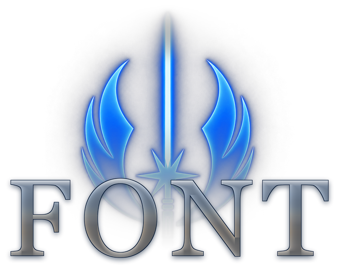
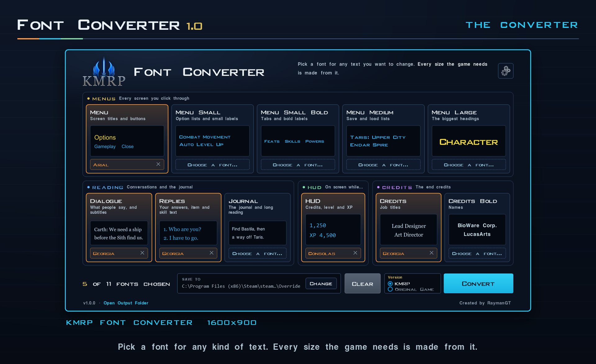
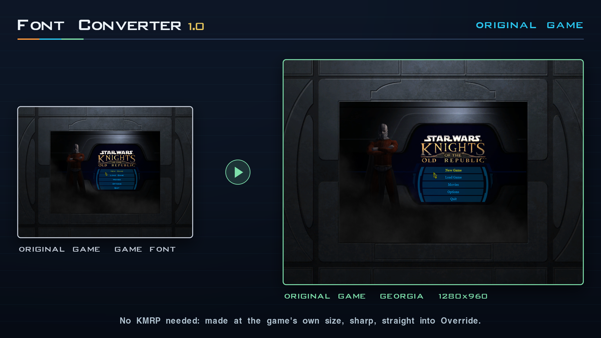
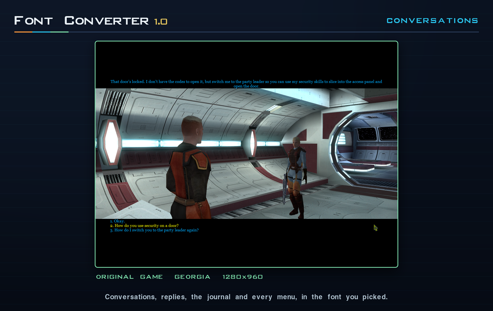
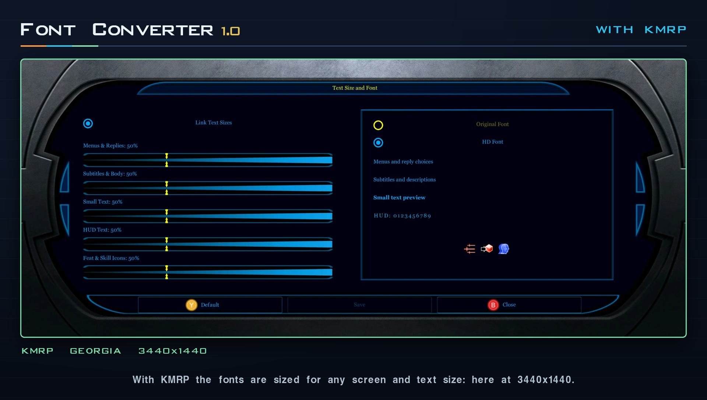

<div align="center">



# KOTOR-KMRP Font Converter

**Any font file into the game fonts of *Star Wars: Knights of the Old Republic* (2003), for KMRP or for the original game.**

KOTOR draws its text from 17 picture fonts, a texture of letters and a text file of
measurements each, so a font can't simply be installed into it. The KMRP Font Converter
makes those files from any TrueType, OpenType or web font: pick a font for the menus, the
dialogue, the journal, the HUD's numbers or the end credits, choose KMRP or the original
game, and convert. This repository also holds the **KMRP Original HD fonts**, KOTOR's own
letters redrawn in high resolution as fonts anyone may use.

[Features](#features) · [Download](#download) · [What it looks like](#what-it-looks-like) · [How it works](#how-it-works) · [The HD fonts](#the-kmrp-original-hd-fonts) · [Build from source](#build-from-source) · [Documentation](#documentation) · [Licence](#licence-and-attribution)

</div>

---

## Features

The KMRP Font Converter 1.0.0, as measured in its reference,
[font-converter.md](font-converter/docs/font-converter.md):

- **Eleven kinds of text, each its own font.** The game's 17 text fonts hold 11
  different sets of letters; each set is one tile: Menu, Menu Small, Menu Small Bold,
  Menu Medium, Menu Large, Dialogue, Replies, Journal, HUD, Credits and Credits Bold.
  Change one or all of them; what you don't pick is left alone.
- **Two versions, chosen beside Convert.** **KMRP** makes the fonts at KMRP's HD size;
  KMRP 1.6.0 or later fits them to your screen and text size and offers them in the game
  as **Modded Font**. **Original Game** makes them at the game's own sizes (10, 12, 14,
  16, 19 and 32 pixels, each found equal to the game's own) with the font's own hinting,
  for a game without KMRP.
- **Font files:** TTF, OTF (both outline kinds), TTC and OTC collections, WOFF and
  WOFF2, and the named instances of a variable font. Type 1, `.fon`, `.dfont`, `.eot`
  and SVG fonts are refused with a message.
- **All or nothing.** Every font is made in a work folder first and moved into place only
  when all are made; a failure, a read-only file or closing the window leaves the folder
  as it was.
- **Nothing lost.** A `.tpc` of the same name, which the game would use instead, is
  renamed rather than deleted. Fonts already there are replaced only after you say so.
- **Refuses what would break the game:** a font missing any letter A to Z or a to z (its
  text would be invisible), an atlas over 4096 pixels, a font file over 128 MB.
- **Windows, macOS and Linux, nothing installed.** One Rust program (since 2026-11-09; until
  then C# for Windows alone): a Windows exe, a macOS app for Apple silicon and Intel, and
  Linux AppImages for x86_64 and aarch64. It finds Steam's (and on Windows GOG's) KOTOR and
  its Override folder by itself, remembers its settings in the system's settings folder
  (`%APPDATA%\KMRP Font Converter` on Windows), and opens in a dark or light window at three
  text sizes, fitted to the screen: on a smaller one everything shrinks evenly, as in KMSE.
- **Missing letters shown, not hidden.** A font without some of the game's letters (Š, Œ,
  € and the like) gets a badge with how many; pointing at it lists them.

In the game it writes only the 34 font files (and renames a `.tpc` of the same name); it
does not change what the text says, or the size of the game's text in the original game.

## Download

> [!IMPORTANT]
> **Not released yet.** 1.0.0 is released on the same day as KMRP 1.6.0 and the KOTOR
> Modern Gamesave Editor. Until then it can be built from this repository
> ([Build from source](#build-from-source)). This section gives the release's link
> once it exists.

**Requirements**

| | |
| --- | --- |
| Game | *Star Wars: Knights of the Old Republic* (2003 PC release). Seen working with GOG's 1.03 `swkotor.exe` (`9C10E045...`) for the original game, and with KMRP on Steam's game |
| For the KMRP version | KMRP 1.6.0 or later. An older KMRP draws these fonts six times too large |
| Windows | 10 or 11, 64-bit: `KOTOR-Font-Converter-<version>-Windows-x64.zip`. Seen working on Windows 11 (2026-11-09) |
| macOS | 11 or later, Apple silicon or Intel (one Universal 2 app): `KOTOR-Font-Converter-<version>-macOS.dmg`. **Not yet run on a Mac**: compiled for both architectures on Windows (type-checked, not linked); the app is made by `build-macos.sh` on a Mac or by the CI workflow, not yet run |
| Linux | x86_64 or aarch64: `KOTOR-Font-Converter-<version>-Linux-<arch>.AppImage`. The x86_64 one converted fonts under WSL's Ubuntu 20.04 (2026-11-09); its window and the aarch64 one: **not yet tried** |
| The game on macOS and Linux | The Windows game through Steam's Proton, CrossOver or Wine: the fonts go in its Override folder |

1. Start the program: `KOTOR-Font-Converter-<version>-Windows-x64.exe`, the app, or the AppImage. Nothing is installed.
2. On a tile, **Choose a font...** or drag a font file onto it.
3. In the **Version** box, choose **KMRP** or **Original Game**. It starts on KMRP when
   it finds KMRP in your game, and remembers your choice.
4. **Convert**. It turns green when the fonts are written.
5. Start the game. With KMRP, Options, Graphics, Text Size and Font shows **Modded Font**
   chosen; HD Font or Original Font there switches back without removing anything.

**Undo.** Delete the 17 font names' `.tga` and `.txi` files from Override, and remove the
ending from any `*.tpc.before-font-converter`. The names are listed in the readme that
comes with the program, [release/README.txt](font-converter/release/README.txt).

**The 1.0.0 Windows program** is 11,238,912 bytes, SHA-256
`DF4B6178C7D7A507BAFE6CAE094A098D5516643487AA9DF20C1F34971582A348`, built
deterministically: the same sources give the same bytes (a rebuild from clean gave the
same SHA-256, 2026-11-09). It is **not signed**, so Windows SmartScreen and some antivirus
programs may warn; it has not yet been scanned on VirusTotal. The macOS app is signed ad
hoc, not notarized.

*Superseded 2026-11-09:* until the Rust rewrite this section gave the C# exe, 840,192
bytes, `81D4BD89...`. 1.0.0 was not released yet, so the version stayed 1.0.0.

## What it looks like









Every frame is a whole screen or window, scaled down and not retouched; where each came
from is in the [press kit's README](font-converter/release/press-kit/README.md).
**Seen in the game so far:** Georgia, made for the original game, in an unmodified GOG
1.03 game at 1280x960 (the menus, Load Game, the inventory, an item's description, the
journal, a conversation and its replies); Georgia made for KMRP on KMRP's Text Size and
Font page at 3440x1440. Not yet looked at in the game: the HUD's numbers, the end credits
and Menu Large.

## How it works

| | KMRP | Original Game |
| --- | --- | --- |
| Size | The KMRP Original HD Font's: six times the game's fonts | The game's own: its fonts' TXI headers line for line (heights, spacing), the HD sizes divided by six |
| Letters | Drawn from the font's outlines, exact-area coverage | Hinted by the font's own instructions (skrifa, FreeType's normal target) and made 0.3 pixels wider, a little wider than Windows drew them, each letter on a whole pixel, so 10-pixel text stays sharp. Until 2026-11-09 drawn by Windows (DirectWrite) |
| Atlas | The size of KMRP 1.6's own HD atlas for each name, so the files are the size of KMRP's (since 2026-11-09; the Journal's three were twice as wide and high before) | The size of the game's own atlas for each name, so the files are the size of the game's (since 2026-11-09; the HUD font's was twice as wide and high before) |
| In the game | KMRP fits them to their drawn size, as Modded Font | The game draws them one texel to one pixel, as its own |

Each font is written as the game's own: a 32-bit TGA atlas and a TXI file of
measurements, Windows-1252 letters, no zero-wide letter, the HUD font with the game's
black ring. Fonts are read by the converter itself on every system (skrifa for TrueType,
OpenType, collections and variable fonts, wuff for WOFF2, its own code for WOFF); until
2026-11-09 Windows' DirectWrite read them. The rules came from measuring the game's atlases, and the regression
test checks every set it writes against them. The whole mechanism, with the measurements,
the corrections and what is deliberately left alone, is in
[font-converter/docs/font-converter.md](font-converter/docs/font-converter.md).

## The KMRP Original HD fonts

KOTOR's own fonts in high resolution: 11 OpenType files and one TrueType collection, one
font for each different set of letters the game uses. Each letter was redrawn as
straight lines, sharp corners and arcs over KMRP's HD atlases, measured rather than
traced, with the game's widths, spacing and baseline to a unit. They are **free to use,
change and share under the [SIL Open Font License 1.1](fonts/OFL.txt)**, in a game, a
mod, an app or a website, without asking.

KMRP draws its in-game HD Font from these files, the converter sets its window in two of
them, and the KOTOR Modern Gamesave Editor uses them too. Hashes, the redraw, the
measurements against the atlases and the rejected methods are in
[fonts/README.md](fonts/README.md); the download for players is
[fonts/release-kit](fonts/release-kit/README.txt).

## Build from source

Building is only needed to change the program; players run the released packages.

**Prerequisites**

- Rust (rustup, stable). On Windows the MSVC toolchain, with Visual Studio's C++ build
  tools or Build Tools (the linker; the Windows SDK's `rc.exe` puts the icon in the exe).
  On macOS Xcode's command line tools and the `aarch64-apple-darwin` and
  `x86_64-apple-darwin` targets. On Linux curl and sha256sum; `--zig` builds with
  `cargo-zigbuild` for glibc 2.31 and either architecture.
- For the test: Python 3 with `fontTools`, `brotli` and Pillow. Windows' own Arial, Cambria,
  Bahnschrift and Georgia are used where they are.
- Only to remake `font-converter/data` or the fonts: a KMRP checkout beside this
  repository, or named by `KMRP_ROOT` (`tools/kmrp_checkout.py`), and Python with Pillow.
  The fonts' own tools list what they need in [fonts/README.md](fonts/README.md)
  section 7.

| System | Command | Makes, in `font-converter/dist/` |
| --- | --- | --- |
| Windows | `powershell -ExecutionPolicy Bypass -File font-converter\build.ps1 -Release` | `KOTOR-Font-Converter-<version>-Windows-x64.exe` and `.zip` |
| macOS | `sh font-converter/build-macos.sh` | `KOTOR-Font-Converter-<version>-macOS.app` (Universal 2), `.dmg` and `.zip` |
| Linux | `sh font-converter/build-linux.sh --arch x86_64` (or `aarch64`) | `KOTOR-Font-Converter-<version>-Linux-<arch>.AppImage` |
| Any | `python tests/Test-FontConverter.py` | The regression test |

Each package holds the readme, the licences and the notices. The test builds the program
and converts nine inputs (TTF, CFF OTF, two collections, a variable font, Georgia, KMRP's
TTF, WOFF, WOFF2) for both versions, checking all 34 files of each set, then feeds it broken
and hostile files and checks nothing is written. With a built KMRP checkout beside this
repository it also compares the original-game fonts with the game's own. The workflow
`.github/workflows/build.yml` runs it on Windows, macOS and Linux and makes the four
packages on demand. The version is written once, as `version` in
`font-converter/Cargo.toml`.

> [!NOTE]
> **Game files are never committed:** no atlas, texture or save of the game's. The
> fonts and atlases in this repository are KMRP's own drawing.

## Repository layout

```
.github/scripts/      check_links.py: every relative link in the documents resolves
.github/workflows/    build.yml: the tests on three systems, the four packages on demand
docs/                 The documentation standard this repository holds itself to
font-converter/       The converter: Rust sources (src/), the three build scripts, its data
                      and window fonts
  docs/               Its reference and its release audit
  release/            The player's readme, the notices, the press kit and its script
fonts/                The KMRP Original HD fonts
  otf/                11 OpenType (CFF) files; KMRP-OriginalHD.ttc beside them holds all 11
  tools/              How they were redrawn (Python); some read KMRP's files
  release-kit/        The fonts' own download, its pictures and the scripts that make them
tests/                Test-FontConverter.py: builds the converter and checks what it writes
tools/                kmrp_checkout.py: finds a KMRP checkout for the tools that need one
```

## Documentation

| | |
| --- | --- |
| [font-converter/docs/font-converter.md](font-converter/docs/font-converter.md) | The converter: every file it writes, both versions, the window, the command line, the build and how to verify it |
| [font-converter/docs/release-audit-2026-11-08.md](font-converter/docs/release-audit-2026-11-08.md) | The release audit and what became of each finding (a lab record) |
| [fonts/README.md](fonts/README.md) | The HD fonts: files and hashes, how they were redrawn, measured, and what was rejected |
| [font-converter/release/README.txt](font-converter/release/README.txt) | The player's readme, shipped in the release zip |
| [CHANGELOG.md](CHANGELOG.md) | What changed, per release |
| [docs/documentation-standard.md](docs/documentation-standard.md) | The standard every document here is held to, taken from KMRP's |
| [AGENTS.md](AGENTS.md) | The working rules for anyone changing this repository, people or agents |

The converter and the fonts were in [KMRP's repository](https://github.com/RayesDiyab/KMRP-KOTOR-Modern-Restoration-Patch)
until 2026-11-08 and came here with their history. KMRP still ships its HD Font
atlases, drawn from these fonts, in its own `assets/hd-original-fonts`.

---

## Licence and attribution

The KMRP Font Converter is free software under the **GNU General Public License,
version 3 or later**, like KMRP ([LICENSE](LICENSE)). The KMRP Original HD fonts, in
`fonts/` and as the two window fonts compiled into the converter, are under the **SIL
Open Font License 1.1** ([fonts/OFL.txt](fonts/OFL.txt)), with no Reserved Font Name.

The program is built from Rust crates by others (egui for the window, skrifa for reading
fonts, wuff for WOFF2 and more), under MIT, Apache-2.0 and similar licences, all compatible
with the GPL-3.0, and carries the fonts egui falls back on (Ubuntu Light, Hack, Noto Emoji);
until the Rust rewrite of 2026-11-09 it carried no one else's code and read fonts through
Windows' DirectWrite. The logos and the program's icon are
KMRP's crest with letters drawn in the Georgia typeface (a picture of the letters, not the
font file); the settings gear is the KMRP installer's own. What the program
carries, and whose, is in
[release/THIRD-PARTY-NOTICES.txt](font-converter/release/THIRD-PARTY-NOTICES.txt).

One point is recorded for whoever redistributes the fonts: KMRP's HD atlases, which the
fonts were redrawn over, were first rendered from Bank Gothic Medium and Helvetica fitted
to the game's letters. No outline of those fonts is in these files, and the reasoning on
typeface designs is in [fonts/README.md](fonts/README.md) section 4. It is reasoning, not
legal advice.

*Star Wars: Knights of the Old Republic* is © 2003 BioWare Corp. / LucasArts. This is an
unofficial fan project, not affiliated with or endorsed by BioWare, LucasArts, Lucasfilm
or Disney. Created by RaymanGT.
